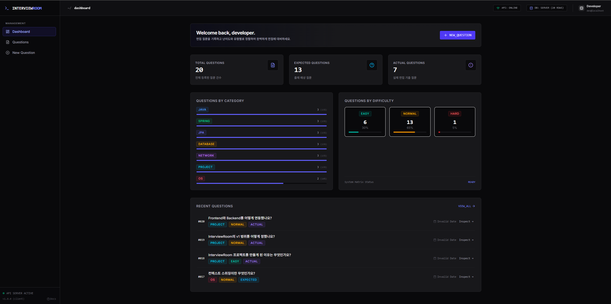
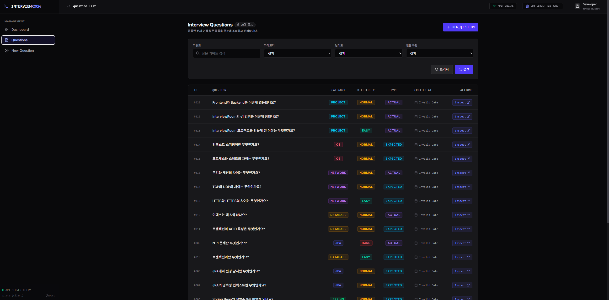
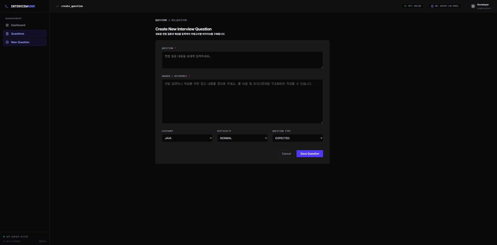

# InterviewRoom

면접 준비 과정에서 예상 질문과 실제 면접 질문을 기록하고, 카테고리·난이도·유형별로 분류하여 관리하는 웹 애플리케이션입니다.

Java/Spring Boot 백엔드 개발을 중심으로 진행하는 개인 프로젝트입니다. 현재 기본적인 질문 CRUD 기능과 프론트엔드·백엔드 API 연동을 구현했으며, 추가 기능 개발 및 기존 기능 개선을 진행하고 있습니다.

## 📸 Screenshots

### 메인 화면


### 질문 목록


### 질문 등록


## 📌 Project Overview

| 항목 | 내용 |
|---|---|
| 개발 형태 | 개인 프로젝트 |
| 개발 기간 | 2026.06 ~ 진행 중 |
| 플랫폼 | Web |
| 현재 상태 | 질문 CRUD 구현 및 API 연동 완료, 추가 개발 진행 중 |

면접 준비 중 정리한 질문을 한곳에 기록하고, 질문의 주제와 난이도, 유형에 따라 체계적으로 관리하기 위해 시작한 프로젝트입니다.

## ✨ Features

| 기능 | 설명 |
|---|---|
| 대시보드 | 전체 질문 수 및 유형·카테고리·난이도별 요약 |
| 질문 등록 | 질문과 답변 및 분류 정보 등록 |
| 질문 조회 | 질문 목록 및 상세 내용 확인 |
| 질문 수정 | 질문 내용, 답변, 분류 정보 변경 |
| 질문 삭제 | 등록된 질문 삭제 |
| 질문 분류 | 카테고리·난이도·예상/실제 질문 구분 |

현재 위 기능의 프론트엔드 및 백엔드 API 연동을 완료했으며, 브라우저와 Postman을 이용해 기본 동작을 확인했습니다.

## 🛠 Tech Stack

| 구분 | 기술 |
|---|---|
| Backend | Java 21, Spring Boot, Spring Data JPA, Spring Web |
| Frontend | React, TypeScript, Vite |
| Database | MySQL |
| Infrastructure | Docker, Home Server VM |
| Tools | Git, GitHub, Gradle, Postman |

### AI 활용

프론트엔드 UI 구성에 AI 개발 도구(Google Antigravity)를 활용했습니다. 백엔드 개발을 중심으로 질문 CRUD REST API와 데이터베이스 연동 기능을 구현했으며, 프론트엔드와 백엔드 간 API 연동 및 기본 동작을 확인했습니다.

## 🏗 Architecture

```text
React Frontend
      |
      | REST API
      v
Spring Boot Backend
      |
      | Spring Data JPA
      v
     MySQL
```

프론트엔드는 사용자 인터페이스를 제공하고, Spring Boot 백엔드는 질문 관리 REST API를 처리합니다.

MySQL은 개인 홈서버의 VM에서 Docker 컨테이너로 실행하고 있습니다.

## ✅ Verification

- Postman을 통한 질문 CRUD API 요청 및 응답 확인
- 브라우저에서 질문 등록·조회·수정·삭제 기능 확인
- 프론트엔드와 백엔드 간 데이터 송수신 확인

현재 확인한 내용은 수동 기능 검증이며, 자동화 테스트와는 구분됩니다.

## 📚 Documentation

- [프로젝트 개요](docs/01-project-overview.md)
- [MVP 개발 범위](docs/02-mvp-scope.md)
- [요구사항 정의서](docs/03-requirements.md)
- [개념 설계서](docs/04-concept-design.md)
- [프로젝트 백로그](docs/05-backlog.md)

## 🚧 Roadmap

기본 CRUD를 바탕으로 검색·정렬·페이징, 복습 관리, 테스트 및 배포 환경 등을 단계적으로 개선할 계획입니다.

세부 개발 계획은 [프로젝트 백로그](docs/05-backlog.md)에서 관리합니다.
